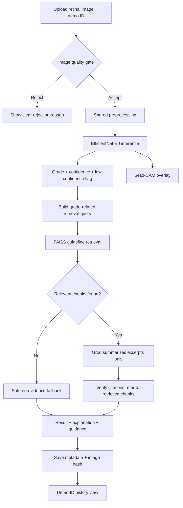

# Architecture — Explanable AI for Retinopathy & Guidance

## 1. System purpose

A portfolio-grade prototype for retinal fundus image classification, visual explanation, and guideline-grounded educational guidance. It is not intended for clinical use.

## 2. Component map

| Component | Responsibility | Input | Output |
|---|---|---|---|
| Streamlit UI | Upload, demo ID, results, sources, history | Image and demo ID | Human-readable result |
| Quality gate | Reject unsuitable images | RGB image | Accept/reject plus reason |
| Preprocessor | Border crop, resize, CLAHE | RGB image | Processed image |
| EfficientNet-B0 | Five-class classification | Normalized tensor | Class logits/probabilities |
| Predictor | Orchestrate inference | RGB image | Grade, confidence, flags |
| Grad-CAM | Visualize regions associated with chosen class | Model and tensor | Heatmap overlay |
| Retriever | Search guideline chunks | Query string | Ranked chunks and scores |
| LLM wrapper | Summarize retrieved excerpts only | Grade, confidence, excerpts | Short cited summary or fallback |
| MongoDB layer | Store screening metadata | Demo ID and result | Persisted record/history |
| Index builder | Parse PDFs, chunk text, embed, index | Approved PDFs | FAISS index and metadata |

## 3. End-to-end data flow

## 4. Preprocessing contract

The same deterministic preprocessing function must be used for training preparation and inference. Avoid training/serving skew.

The blueprint specifies:
1. Crop the black border.
2. Resize to 256×256.
3. Convert RGB to LAB.
4. Apply CLAHE to the L channel.
5. Convert back to RGB.

Training augmentation is separate from deterministic preprocessing and must only be applied to training examples. Evaluation and inference use consistent normalization.

Quality-gate thresholds in the blueprint are starting points only. Calibrate them against the dataset and document false rejections. Do not assume a colour heuristic reliably establishes that an image is a retinal fundus photo.

## 5. Model and labels

- Backbone: torchvision EfficientNet-B0
- Output classes: 5
- Label IDs: 0 No DR, 1 Mild, 2 Moderate, 3 Severe, 4 Proliferative DR
- Imbalance handling: class-weighted cross-entropy as a baseline
- Model selection: validation quadratic weighted kappa (QWK)
- Final evaluation: untouched test split
- Explainability: Grad-CAM targeting the last feature block

A Grad-CAM overlay indicates regions that influence the selected model output under this method. It does not establish that the model used medically meaningful features or that the prediction is correct.

## 6. Retrieval and grounded generation

1. Extract text from permitted guideline PDFs with `pypdf`.
2. Normalize whitespace and chunk text with overlap.
3. Embed chunks using `sentence-transformers/all-MiniLM-L6-v2`.
4. Build a FAISS inner-product index over normalized embeddings.
5. Retrieve top-k chunks and filter by a tuned similarity threshold.
6. Give the LLM only the retrieved excerpts and a constrained task.
7. Require citations in the form `[1]` that map to source and page metadata.
8. If no evidence is retrieved, return a safe fallback without asking the LLM to improvise.

Similarity scores are retrieval signals, not clinical relevance guarantees. Human-review sample queries and retrieved excerpts before release.

## 7. Data persistence

Store only the fields required for the demonstration:
- Demo patient ID
- UTC creation timestamp
- SHA-256 hash of the original upload bytes
- Grade and label
- Confidence and low-confidence flag
- Referable-range flag (grade ≥2, project convention)
- Guidance text
- Source identifiers, pages, and retrieval scores

Do **not** store the uploaded image itself. Use synthetic/demo IDs only. Add database access controls and a retention policy before any broader use.

## 8. Failure boundaries

| Failure | Expected behaviour |
|---|---|
| Invalid/non-image file | Clear UI error; no inference |
| Quality gate rejects image | Explain rejection and request a better image |
| Model checkpoint missing/corrupt | Startup or inference error with actionable message; no fabricated prediction |
| Low confidence | Visible warning and manual-review wording |
| No guideline chunks | Safe fallback; no generated medical advice |
| Groq unavailable | Guidance-unavailable fallback; classification result may still be displayed with warning |
| MongoDB unavailable | Show result but report that saving/history is unavailable |
| Missing index or metadata | Clear startup error; do not silently return empty evidence |
| Citation cannot be mapped to a retrieved source | Do not present the citation as verified |

## 9. Environment configuration

Use `.env.example` to document variable names only. `.env` is local and ignored by Git.

- `GROQ_API_KEY`
- `GROQ_MODEL`
- `MONGODB_URI`
- `MONGODB_DB`

Verify the chosen Groq model against the current provider console at implementation time. Do not hard-code a model identifier in multiple files.

## 10. Deferred improvements

- Add FastAPI only if the service boundary is needed.
- Calibrate probabilities and confidence thresholds on validation data.
- Add external validation and subgroup analysis where legally and ethically appropriate.
- Add structured citation verification.
- Add dependency lockfile, automated tests, logging, and model/data version metadata.
- Consider deployment only after local end-to-end tests pass and memory constraints are measured.
